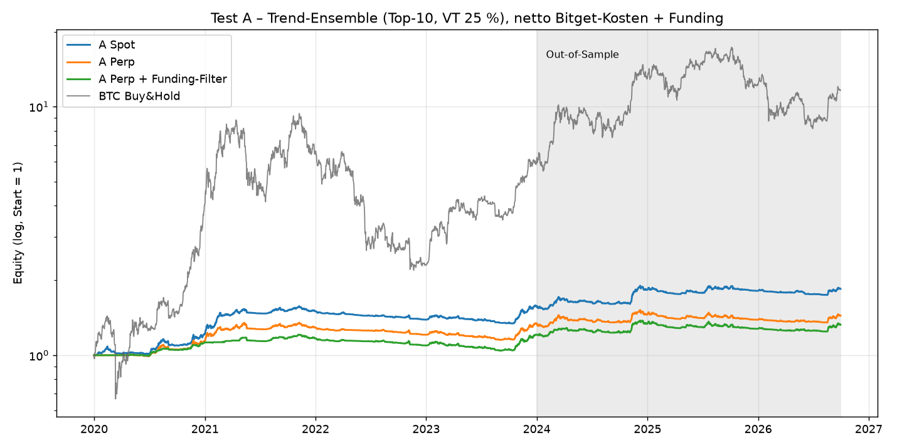
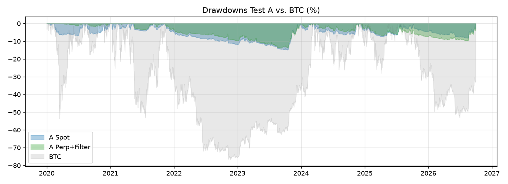

# Backtest-Bericht: Trend-Ensemble (A), Funding-Carry (B), Kombination (C)

**Stand:** 18.10.2026
**Daten:** Binance Vision, Tageskerzen und Funding, 01.01.2020 – 30.09.2026
**Kosten:** Bitget (Gebühren, Slippage, echtes Funding, Mindestordergrößen)

Code, Rohdaten und Logs liegen unter `/workspace/research/bt2/`, die Charts unter `/workspace/research/charts/`. Alle Zahlen in diesem Bericht stammen aus diesen Läufen; nichts ist geschätzt oder ergänzt.

---

## 0. Ergebnis in einem Satz je Test

| Test | Ergebnis | Entscheidung |
|---|---|---|
| **A – Trend-Ensemble Spot** | Besteht alle Prüfungen (siehe unten). OOS-Sharpe 0,81, Walk-Forward-Sharpe 0,73, PBO 0,19, Deflated Sharpe 0,98, alle 18 Konfigurationen OOS positiv. **Aber:** Rendite klein (OOS 6,2 % p.a. bei 7,8 % Volatilität), und nach Paper-Veröffentlichung nur noch Sharpe 0,42 | **Paper-Trading: JA** |
| A – Trend-Ensemble Perp | Deutlich schwächer als Spot: OOS-Sharpe 0,41, Funding kostet 1,3 % p.a. Mit 100–500 USDT wegen Mindestorder kaum handelbar | Nein (Spot ist besser) |
| A – Perp + Funding-Filter | Senkt die Funding-Kosten auf 0,3 % p.a. und hebt den OOS-Sharpe auf 0,53. Kostet aber Bull-Rendite (2021: +3,9 % statt +13,3 %). PBO 0,50 (Grenze) | Nein |
| **B – Funding-Carry (vorab registriert)** | OOS-Sharpe **−0,58**, Walk-Forward −0,58, PBO **0,89**, MaxDD **−91 %** (Short-Squeeze MYX, Sept. 2025) | **Abbruchkriterium erfüllt → verworfen** |
| B – explorativ mit isolierter Marge | OOS-Sharpe 0,82, aber Walk-Forward **−0,44** und PBO **0,52**. Die Variante wurde erst nach Sicht der Ergebnisse ergänzt | Ebenfalls Abbruch |
| **C – 50 % A-Spot + 50 % B (vorab)** | OOS-Sharpe −0,27, MaxDD −49 %. 2022: −13,7 % (A allein −7,5 %). 2025: −43,9 % | **Keine Glättung → verworfen** |
| C – explorativ (B isoliert) | OOS-Sharpe 1,01, MaxDD −18 %. Glättet 2022 aber **nicht** (−15,8 % vs. −7,5 %). Beruht auf einer B-Variante, die selbst durchfällt | Nicht empfohlen |

**Empfehlung:** Paper-Trading für **A-Spot** in der vorab festgelegten Primärvariante. Technisch ab 100 USDT möglich, sinnvoll ab etwa 500 USDT. B und C nicht weiter verfolgen. Details in Abschnitt 7.

---

## 1. Methodik (vorab registriert)

Vor dem ersten Lauf wurden alle Regeln in `/workspace/research/bt2/PREREG.md` festgelegt:

| Punkt | Festlegung |
|---|---|
| **In-Sample** | 01.01.2020 – 31.12.2023 |
| **Out-of-Sample** | 01.01.2024 – 30.09.2026 (33 Monate) |
| **Walk-Forward** | Jährlich expandierend; die Konfiguration mit dem besten Sharpe der Vorjahre wird im Folgejahr gehandelt (2022–2026) |
| **Universum (survivorship-frei)** | Alle jemals auf Binance gelisteten USDT-Spot-Paare (702) bzw. USDⓈ-M-Perps (895), **inklusive delisteter Coins** (z. B. LUNA, FTT, SRM). Monatlich die Top-B nach 30-Tage-Median-Volumen zum damaligen Zeitpunkt, mindestens 2 Mio. USD Median-Volumen und 60 Tage Historie |
| **Ausschlüsse** | Stablecoins, Fiat, Gold, Wrapped Tokens, Index-Perps, Tokenized Stocks und TradFi-Perps; Liste in `excluded.json`. Ticker-Neustarts (z. B. LUNA → LUNA 2.0) werden als eigene Assets geführt. Delistete Positionen werden zum letzten Schlusskurs geschlossen |
| **Kosten Perp** | Taker 0,06 % + 0,05 % Slippage je Seite (Basis). Maker-Szenario: 0,02 % |
| **Kosten Spot** | 0,10 % + 0,05 % Slippage (Basis). Optimistisch: 0,08 % mit BGB-Rabatt |
| **Funding** | Tatsächliche Binance-Funding-Sätze, Tagessumme |
| **Mindestorder** | Bitget-Specs vom 18.10.2026 (Perp: 5 USDT plus Kontraktgröße; Spot: 1 USDT bei Majors, sonst 10–20 USDT), simuliert für 100/250/500/1000/5000 USDT |
| **Statistik** | Deflated Sharpe (Bailey & López de Prado 2014) mit N = Gittergröße. PBO per CSCV mit 16 Blöcken und allen 12.870 Kombinationen. Stationärer Block-Bootstrap mit mittlerer Blocklänge 20 Tage, 10.000 Pfade à 365 Tage, gemeinsam mit BTC gezogen |

**Test A** übernimmt die Regeln aus Zarattini/Pagani/Barbon 2025:
- 9 Donchian-Fenster (5–360 Tage)
- Trailing-Stop am Mittelband
- Volatilitätsziel 25 % je Coin, Cap 1,0 auf Spot bzw. 2,0 auf Perp
- 20 %-Rebalance-Schwelle
- Je Coin 1/B des Kapitals

Primärvariante: alle 9 Fenster, Top-10, Volatilitätsziel 25 %. Gitter mit 18 Konfigurationen: Fenster {alle | kurz | lang} × B {5, 10, 20} × Volatilitätsziel {25 %, 50 %}. Funding-Filter vorab fixiert: Liegt das 7-Tage-Mittel des Fundings über 0,03 % je 8 h, wird das Gewicht 0 gesetzt.

**Test B** folgt Vine 2026:
- Top-30 Perps
- Signal: Funding-Mittel über L Tage, um einen Tag verzögert
- Long unteres, Short oberes Quantil, dollar-neutral, Brutto-Exposure 1,0
- Primärvariante: L = 7, Terzile, wöchentlich
- Gitter mit 36 Konfigurationen

**Abbruch**, wenn OOS-Sharpe < 0,3 oder PBO > 0,5.

**Test C:** 50/50 aus A-Primär (Venue nach IS-Sharpe vorab gewählt; Spot hatte mit 1,35 den höchsten) und B-Primär, monatlich rebalanciert.

---

## 2. Test A – Trend-Ensemble

### Kernaussagen A

1. **Spot schlägt Perp deutlich.** Gesamt-Sharpe 1,14 vs. 0,76, OOS 0,81 vs. 0,41. Zwei Gründe:
   - Long-Positionen auf Perps zahlen **1,28 % p.a. Funding**, gemessen am Gesamtkapital. Bei rund 9 % Exposure ist das ein großer Teil der Rendite.
   - Das Perp-Universum enthält mehr kurzlebige Hype-Coins.
2. **Der Funding-Filter hilft kaum.** Er senkt den Funding-Drag auf 0,32 % p.a. und hebt den OOS-Sharpe von 0,41 auf 0,53. Er schneidet aber genau die stärksten Bull-Trends ab: 2021 +3,9 % statt +13,3 %. Gesamt-Sharpe 0,73 vs. 0,76 ohne Filter; PBO 0,50.
3. **Robustheit Spot:**
   - Alle 18 Konfigurationen sind OOS positiv (Sharpe 0,39–0,88).
   - PBO 0,19 (gering), Deflated Sharpe 0,98.
   - Walk-Forward 2022–2026: Sharpe 0,73, CAGR 6,1 %, MaxDD −11,3 %. Gewählt wurde jedes Jahr „kurze Fenster, Top-10, Volatilitätsziel 25 %“.
4. **Der OOS-Zeitraum allein ist nicht signifikant.** OOS-Sharpe 0,81 über 2,75 Jahre ergibt t ≈ 1,34, die Wahrscheinlichkeit für einen echten Sharpe > 0 liegt bei 0,91. Das ist kein 5 %-Signifikanzniveau.
5. **Nach Veröffentlichung des Papers (20.03.2025 – 30.09.2026):**

   | | CAGR | Sharpe | MaxDD |
   |---|---|---|---|
   | A-Spot | 2,5 % | 0,42 | −8,0 % |
   | BTC Buy&Hold | −2,4 % | 0,15 | −53,0 % |

   Der Effekt schwächt sich ab, ist aber noch positiv.
6. **Kein BTC-Ersatz.** CAGR 9,5 % vs. 43,8 % für BTC über den Gesamtzeitraum. Die Stärke ist der Drawdown:

   | Zeitraum | A-Spot | BTC |
   |---|---|---|
   | 2022 | −7,5 % | −64,2 % |
   | Max. Drawdown gesamt | −14,9 % | −76,6 % |

   Mit Volatilitätsziel 50 % verdoppeln sich Rendite und Drawdown ungefähr: OOS-CAGR 11,1 %, MaxDD gesamt −27,5 %.
7. **Kosten sind nicht das Problem.** Bei einem Turnover von 4–5× p.a. kosten Spot-Trades 0,71 % p.a. Mit BGB-Rabatt (0,08 %) steigt der OOS-Sharpe nur von 0,81 auf 0,86.

---

## 3. Test B – Cross-sektionaler Funding-Carry

### Kernaussagen B

1. **In-Sample sah B gut aus.** 2020–2023: Sharpe 1,05 netto, 1,27 brutto, CAGR 22 %.
2. **Out-of-Sample bricht B ein.** Ursache ist ein einziges Ereignis: Der Coin **MYX** stand wegen hohen Fundings auf der Short-Seite.
   - Kurs: 1,31 USDT am 06.09.2025, **16,60 USDT am 10.09.2025** (×12,7)
   - Das Funding drehte gleichzeitig auf bis zu **−16,7 % pro Tag** zulasten der Shorts
   - Ergebnis mit Cross-Margin: −88,6 % im Jahr 2025, MaxDD −91,3 %

   Dieses Short-Squeeze-Risiko hatte Vine 2026 als Hauptrisiko genannt.
3. **Auch ohne das Ereignis ist B instabil.**
   - Nur 10 von 36 Konfigurationen sind OOS positiv.
   - Walk-Forward-Sharpe −0,58, PBO 0,89, Deflated Sharpe 0,04.
   - Kalenderjahre: 2021 +136 %, 2022 −20 %. Die In-Sample-Stärke kommt fast nur aus 2021.
4. **Explorativ, erst nach Sicht der Ergebnisse ergänzt:** isolierte 1×-Marge je Short, Liquidation, sobald das Tageshoch das Doppelte des Einstiegs erreicht. Damit ist der Verlust je Position auf deren Marge begrenzt.
   - Mit 33 Liquidationen kommt B auf OOS-Sharpe 0,82 und MaxDD −32 %.
   - Walk-Forward-Sharpe aber **−0,44** und PBO **0,52**. Das Abbruchkriterium greift also auch hier.
   - Die Variante ist nicht vorab registriert und daher ohnehin nur ein Hinweis.
5. **Kosten:** Turnover 43–50× p.a. Brutto liegt der Sharpe gesamt bei 0,10, netto bei −0,02. Maker-Ausführung rettet die Strategie nicht.

**Entscheidung: B wird gemäß Abbruchkriterium verworfen.**

---

## 4. Test C – Kombination

1. **Die Korrelation von A-Spot und B ist leicht negativ** (−0,06 täglich, gesamt). Rechnerisch ergäbe das Diversifikation.
2. **C hat die Glättung in Seitwärtsphasen nicht geliefert:**
   - **2022:** B verlor selbst 20 %. C (vorab) −13,7 %, explorativ −15,8 %, gegenüber −7,5 % für A allein. Die Kombination war also schlechter als A allein.
   - **2025:** C (vorab) −43,9 % durch den B-Crash. Explorativ +1,3 % gegenüber −0,9 % für A allein; das ist kaum ein Unterschied.
3. **C explorativ** (OOS-Sharpe 1,01, MaxDD −18 %) sieht attraktiv aus, steht aber auf einem B-Baustein, der Walk-Forward und PBO nicht besteht. **Nicht verwenden.**

---

## 5. Mindestordergrößen (Bitget) und Kapital

| Strategie | Kapital | Wirkung |
|---|---|---|
| **A-Spot** | ab 100 USDT | Funktioniert, weil Bitget-Spot bei Majors nur 1 USDT Mindestorder verlangt. 100 USDT: Sharpe 1,22, CAGR 9,4 %; 1000 USDT: 1,15 / 9,5 % |
| **A-Perp** | 100 USDT | Praktisch **keine einzige Order** möglich (Exposure 0,000), da 5 USDT Mindestnotional und Kontraktgrößen |
| A-Perp | 1000 USDT | Exposure 0,069 statt 0,088 ideal; erst ab etwa 5000 USDT nahe am Idealwert |
| **B** | 100 USDT | Nicht handelbar (Exposure 0,066 statt ~0,97) |
| B | ab 250 USDT | Technisch machbar; strategisch verworfen |

**Ehrliche Einordnung:** Bei 100 USDT bringt A-Spot rund 6–9 USDT pro Jahr. Der Bot ist dann ein Lern- und Validierungsprojekt, kein Einkommen.

---

## 6. Monte-Carlo (12 Monate, Block-Bootstrap)

| Strategie (Stichprobe 2020–09/2026) | P(Gewinn) | Median | 5 %-Quantil | 95 %-Quantil | P(MaxDD > 30 %) | P(besser als BTC) |
|---|---|---|---|---|---|---|
| **A-Spot** | 79,0 % | +8,3 % | −6,5 % | +32,2 % | 0,0 % | 31,2 % |
| A-Perp + Filter | 70,0 % | +3,7 % | −6,2 % | +18,0 % | 0,0 % | 29,4 % |
| B Cross-Margin | 67,8 % | +14,9 % | −88,2 % | +81,6 % | 20,9 % | 35,1 % |
| C (vorab) | 73,7 % | +12,0 % | −40,0 % | +47,1 % | 13,5 % | 32,3 % |
| BTC Buy&Hold | 71,6 % | +42,7 % | −51,1 % | +307 % | 78,0 % | – |

Nimmt man **nur die OOS-Stichprobe** (2024–09/2026), sinken die Werte für A-Spot: P(Gewinn) 70,3 %, Median +4,9 %, P(MaxDD > 30 %) 0,0 %. Die vollständigen Tabellen stehen im Anhang.

**Lesart:** A-Spot verliert in etwa 1 von 4–5 Jahren leicht, ein Drawdown über 30 % kam in keinem Pfad vor. In etwa 2 von 3 Jahren liegt A-Spot aber hinter BTC. Der Bootstrap setzt voraus, dass die Vergangenheit repräsentativ ist; neue Regime wie der Post-Publication-Decay deckt er nicht ab.

---

## 7. Empfehlung

**Paper-Trading starten: JA, aber nur mit A-Spot.**

**Variante (vorab fixiert, nicht nachoptimieren):**
- Donchian-Ensemble mit allen 9 Fenstern (5/10/20/30/60/90/150/250/360)
- Trailing-Stop am Mittelband
- Volatilitätsziel 25 % je Coin, kein Hebel (Cap 1,0)
- Top-10 nach 30-Tage-Median-Volumen, monatlich neu bestimmt
- Ausführung täglich nach dem 00:00-UTC-Schlusskurs
- 20 %-Rebalance-Schwelle
- Bitget-**Spot**

Wer mehr absolute Rendite und mehr Schwankung akzeptiert, kann Volatilitätsziel 50 % nehmen (historisch MaxDD ca. −28 %). Das ist eine Risikoentscheidung, keine Optimierung.

Die Variante „kurze Fenster“ war in-sample und out-of-sample leicht besser (OOS-Sharpe 0,88). Sie sollte höchstens als zweiter, paralleler Paper-Account laufen, nicht als Ersatz, weil ihre Auswahl ex post erfolgte.

**Kapital:** Technisch ab 100 USDT. Sinnvoll für eine belastbare Messung von Ausführung, Slippage und Mindestorder sind ≥ 500 USDT (Paper). Echtes Geld frühestens nach 6 Monaten Paper-Trading ohne Regelverletzung.

**Erwartung für 12 Monate:**
- Rendite: 3–8 % p.a. (Volatilitätsziel 25 %)
- Sharpe: eher 0,4–0,8; die Paper-Sharpe von 1,6 nicht erwarten
- BTC wird in Bullenjahren klar verfehlt

**Abbruch- und Prüfkriterien für das Paper-Trading:**
- Drawdown > 15 % (VT 25 %) bzw. > 30 % (VT 50 %), denn das liegt außerhalb der Backtest-Historie
- Abweichung der Paper-Rendite vom parallel laufenden Backtest um mehr als 3 Prozentpunkte über 3 Monate (Hinweis auf Ausführungs- oder Datenprobleme)

**Nicht starten:**
- B (Funding-Carry), in keiner Variante
- C
- A auf Perps unter 5000 USDT

**Prozess:** Kein Merge oder Deploy ohne deine ausdrückliche Freigabe, keine Secrets im Code, kein Push auf main.

---

## 8. Grenzen dieser Tests

1. **Volumen statt Marktkapitalisierung.** Binance Vision liefert keine Marktkapitalisierung. Das Ranking nach Volumen folgt dem Paper.
2. **Survivorship-frei nur innerhalb von Binance.** Coins, die nie auf Binance gelistet waren, fehlen. Delistete Coins werden zum letzten Schlusskurs geschlossen; das ist optimistisch, falls der Handel vorher ausgesetzt wurde.
3. **Binance-Preise statt Bitget-Preise.** Kursunterschiede liegen typischerweise im Basispunktbereich. 3 von 39 Spot-Coins aus dem A-Universum seit 2024 gibt es heute nicht auf Bitget-Spot: 1000SATS (evtl. unter anderem Ticker), DEXE, NEIRO.
4. **Ausführung zum Tagesschluss**, Slippage pauschal 0,05 %. Kein Orderbuch-Modell.
5. **Liquidationsmodell (nur B explorativ) vereinfacht:** Auslösung beim Doppelten des Einstiegs; Wartungsmarge und Gebühren ignoriert.
6. **Statistische Aussagekraft:** 6,75 Jahre Daten, davon 2,75 Jahre OOS. Die OOS-Phase von A allein ist nicht signifikant (t ≈ 1,3). Belastbar ist vor allem die Kombination aus Walk-Forward, niedrigem PBO und durchweg positiven Konfigurationen.
7. **Mindestordergrößen** stammen aus den heutigen Bitget-Specs. Historisch können sie anders gewesen sein.

---

## Anhang – Vollständige Kennzahlentabellen

Automatisch erzeugt aus `analyze.py`, Kopie in `bt2/tables.md`.

#### A – Primärvariante (alle 9 Fenster, Top-10, VT 25 %)

| Variante | Periode | CAGR | Vol | Sharpe | MaxDD | Calmar | Ø Exposure | Turnover p.a. |
|---|---|---|---|---|---|---|---|---|
| Spot | IS 2020–2023 | 11.9 % | 8.6 % | 1.35 | -14.9 % | 0.80 | 0.09 | 4.3× |
| Spot | OOS 2024–09/2026 | 6.2 % | 7.8 % | 0.81 | -8.2 % | 0.75 | 0.12 | 5.5× |
| Spot | Gesamt | 9.5 % | 8.3 % | 1.14 | -14.9 % | 0.64 | 0.10 | 4.7× |
| Perp | IS 2020–2023 | 7.5 % | 7.6 % | 0.99 | -15.0 % | 0.50 | 0.08 | 3.8× |
| Perp | OOS 2024–09/2026 | 2.9 % | 7.5 % | 0.41 | -10.9 % | 0.26 | 0.10 | 4.7× |
| Perp | Gesamt | 5.6 % | 7.5 % | 0.76 | -15.0 % | 0.37 | 0.09 | 4.2× |
| Perp + Funding-Filter | IS 2020–2023 | 4.8 % | 5.3 % | 0.92 | -13.9 % | 0.35 | 0.06 | 4.0× |
| Perp + Funding-Filter | OOS 2024–09/2026 | 3.4 % | 6.8 % | 0.53 | -9.6 % | 0.36 | 0.10 | 4.9× |
| Perp + Funding-Filter | Gesamt | 4.3 % | 5.9 % | 0.73 | -13.9 % | 0.31 | 0.07 | 4.4× |
| Spot (Kosten 0,08 %) | IS 2020–2023 | 12.2 % | 8.6 % | 1.39 | -14.4 % | 0.85 | 0.09 | 4.3× |
| Spot (Kosten 0,08 %) | OOS 2024–09/2026 | 6.6 % | 7.8 % | 0.86 | -7.6 % | 0.86 | 0.12 | 5.5× |
| Spot (Kosten 0,08 %) | Gesamt | 9.9 % | 8.3 % | 1.18 | -14.4 % | 0.69 | 0.10 | 4.7× |
| Perp Maker (0,02 %) | IS 2020–2023 | 7.8 % | 7.6 % | 1.04 | -14.4 % | 0.54 | 0.08 | 3.8× |
| Perp Maker (0,02 %) | OOS 2024–09/2026 | 3.3 % | 7.5 % | 0.47 | -10.3 % | 0.32 | 0.10 | 4.7× |
| Perp Maker (0,02 %) | Gesamt | 6.0 % | 7.5 % | 0.81 | -14.4 % | 0.41 | 0.09 | 4.2× |
| Perp+Filter Maker | IS 2020–2023 | 5.2 % | 5.3 % | 0.99 | -13.4 % | 0.39 | 0.06 | 4.0× |
| Perp+Filter Maker | OOS 2024–09/2026 | 3.9 % | 6.8 % | 0.60 | -9.0 % | 0.43 | 0.10 | 4.9× |
| Perp+Filter Maker | Gesamt | 4.7 % | 5.9 % | 0.80 | -13.4 % | 0.35 | 0.07 | 4.4× |
| BTC Buy&Hold | IS 2020–2023 | 55.7 % | 67.7 % | 1.00 | -76.6 % | 0.73 | – | – |
| BTC Buy&Hold | OOS 2024–09/2026 | 28.1 % | 47.3 % | 0.76 | -53.0 % | 0.53 | – | – |
| BTC Buy&Hold | Gesamt | 43.8 % | 60.2 % | 0.91 | -76.6 % | 0.57 | – | – |

#### A – Nach Veröffentlichung des Papers (20.03.2025 – 30.09.2026)

| Variante | CAGR | Vol | Sharpe | MaxDD | Calmar |
|---|---|---|---|---|---|
| Spot | 2.5 % | 6.4 % | 0.42 | -8.0 % | 0.32 |
| Perp | 1.4 % | 6.1 % | 0.25 | -8.8 % | 0.15 |
| Perp + Funding-Filter | 1.4 % | 6.1 % | 0.27 | -8.8 % | 0.16 |
| Spot (Kosten 0,08 %) | 3.0 % | 6.4 % | 0.49 | -7.6 % | 0.39 |
| Perp Maker (0,02 %) | 1.8 % | 6.1 % | 0.33 | -8.4 % | 0.22 |
| Perp+Filter Maker | 1.9 % | 6.1 % | 0.34 | -8.4 % | 0.23 |
| BTC Buy&Hold | -2.4 % | 42.0 % | 0.15 | -53.0 % | -0.05 |

#### A – Alle 18 Konfigurationen (Spot) netto

| Fenster | B | VT | Sharpe IS | Sharpe OOS | CAGR OOS | MaxDD gesamt |
|---|---|---|---|---|---|---|
| all | 5 | 25 % | 1.16 | 0.65 | 5.9 % | -16.7 % |
| all | 5 | 50 % | 1.13 | 0.65 | 10.8 % | -30.5 % |
| all | 10 | 25 % | 1.35 | 0.81 | 6.2 % | -14.9 % |
| all | 10 | 50 % | 1.33 | 0.78 | 11.1 % | -27.5 % |
| all | 20 | 25 % | 1.26 | 0.53 | 3.3 % | -11.8 % |
| all | 20 | 50 % | 1.25 | 0.50 | 5.8 % | -22.1 % |
| long | 5 | 25 % | 0.88 | 0.55 | 5.3 % | -21.6 % |
| long | 5 | 50 % | 0.87 | 0.52 | 8.8 % | -38.2 % |
| long | 10 | 25 % | 1.05 | 0.65 | 5.1 % | -16.6 % |
| long | 10 | 50 % | 1.02 | 0.61 | 8.8 % | -30.6 % |
| long | 20 | 25 % | 0.94 | 0.41 | 2.5 % | -13.5 % |
| long | 20 | 50 % | 0.93 | 0.39 | 4.3 % | -25.2 % |
| short | 5 | 25 % | 1.34 | 0.67 | 6.6 % | -15.5 % |
| short | 5 | 50 % | 1.31 | 0.70 | 12.5 % | -27.3 % |
| short | 10 | 25 % | 1.54 | 0.88 | 7.5 % | -12.9 % |
| short | 10 | 50 % | 1.52 | 0.85 | 13.4 % | -24.1 % |
| short | 20 | 25 % | 1.42 | 0.55 | 4.1 % | -10.8 % |
| short | 20 | 50 % | 1.42 | 0.53 | 7.1 % | -21.4 % |

#### A – Kalenderjahre (netto)

| Variante | 2020 | 2021 | 2022 | 2023 | 2024 | 2025 | 2026 |
|---|---|---|---|---|---|---|---|
| Spot | 21.7 % | 23.5 % | -7.5 % | 12.7 % | 16.8 % | -0.9 % | 1.8 % |
| Perp | 14.0 % | 13.3 % | -6.4 % | 10.4 % | 9.2 % | -4.7 % | 3.8 % |
| Perp + Funding-Filter | 12.6 % | 3.9 % | -6.4 % | 10.4 % | 10.8 % | -4.6 % | 3.8 % |
| BTC Buy&Hold | 302.0 % | 59.8 % | -64.2 % | 155.6 % | 121.3 % | -6.3 % | -4.6 % |

Funding-Kosten p.a. (Anteil am Kapital, Gesamtzeitraum): Perp 1.28 %, Perp+Filter 0.32 %. Handelskosten p.a.: Spot 0.71 %, Perp 0.46 %, Perp+Filter 0.48 %

#### A – Robustheit über das Konfigurationsgitter (18 Konfigurationen je Venue)

| Venue | Sharpe IS (min–max) | Sharpe OOS (min–max) | OOS positiv | IS-beste Konfig → OOS-Sharpe | Walk-Forward-Sharpe 2022–26 | WF-CAGR | WF-MaxDD | PBO | DSR (Primär) |
|---|---|---|---|---|---|---|---|---|---|
| spot | 0.87–1.54 | 0.39–0.88 | 18/18 | ('spot', 'short', np.int64(10), np.float64(0.25)) → 0.88 | 0.73 | 6.1 % | -11.3 % | 0.19 | 0.98 |
| perp | 0.68–1.22 | 0.06–0.49 | 18/18 | ('perp', 'short', np.int64(10), np.float64(0.25)) → 0.48 | 0.40 | 4.0 % | -22.6 % | 0.26 | 0.89 |
| perp+filter | 0.55–1.20 | 0.14–0.59 | 18/18 | ('perp+filter', 'short', np.int64(5), np.float64(0.25)) → 0.52 | 0.42 | 5.5 % | -29.0 % | 0.50 | 0.87 |

#### B – Funding-Carry (L=7, Terzile, wöchentlich)

| Variante | Periode | CAGR | Vol | Sharpe | MaxDD | Calmar | Ø Exposure | Turnover p.a. |
|---|---|---|---|---|---|---|---|---|
| B Primär (Cross-Margin, Taker+Slip) | IS 2020–2023 | 22.1 % | 21.3 % | 1.05 | -25.9 % | 0.86 | 0.94 | 43.0× |
| B Primär (Cross-Margin, Taker+Slip) | OOS 2024–09/2026 | -45.9 % | 58.9 % | -0.58 | -91.3 % | -0.50 | 1.00 | 49.9× |
| B Primär (Cross-Margin, Taker+Slip) | Gesamt | -12.3 % | 41.0 % | -0.02 | -91.3 % | -0.14 | 0.97 | 45.8× |
| B Primär Maker 0,02 % | IS 2020–2023 | 26.9 % | 21.3 % | 1.23 | -23.5 % | 1.15 | 0.94 | 43.0× |
| B Primär Maker 0,02 % | OOS 2024–09/2026 | -43.1 % | 58.6 % | -0.51 | -90.9 % | -0.47 | 1.00 | 49.9× |
| B Primär Maker 0,02 % | Gesamt | -8.4 % | 40.9 % | 0.08 | -90.9 % | -0.09 | 0.97 | 45.8× |
| B Primär brutto (0 Kosten) | IS 2020–2023 | 28.0 % | 21.3 % | 1.27 | -22.9 % | 1.22 | 0.94 | 43.0× |
| B Primär brutto (0 Kosten) | OOS 2024–09/2026 | -42.4 % | 58.5 % | -0.49 | -90.8 % | -0.47 | 1.00 | 49.9× |
| B Primär brutto (0 Kosten) | Gesamt | -7.5 % | 40.8 % | 0.10 | -90.8 % | -0.08 | 0.97 | 45.8× |
| B explorativ: isolierte 1×-Marge je Short (Liq. bei Tageshoch) | IS 2020–2023 | 19.3 % | 21.0 % | 0.95 | -29.4 % | 0.66 | 0.94 | 42.9× |
| B explorativ: isolierte 1×-Marge je Short (Liq. bei Tageshoch) | OOS 2024–09/2026 | 18.8 % | 24.8 % | 0.82 | -30.4 % | 0.62 | 0.99 | 48.0× |
| B explorativ: isolierte 1×-Marge je Short (Liq. bei Tageshoch) | Gesamt | 19.1 % | 22.6 % | 0.89 | -32.1 % | 0.59 | 0.96 | 45.0× |

#### B – Robustheit (36 Konfigurationen) und Abbruchkriterium

| Variante | Sharpe IS (min–max) | Sharpe OOS (min–max) | OOS positiv | OOS-Sharpe Primär | Walk-Forward-Sharpe | PBO | DSR | Abbruch? |
|---|---|---|---|---|---|---|---|---|
| Cross-Margin (vorab registriert) | 0.06–1.21 | -0.94–1.07 | 10/36 | -0.58 | -0.58 | 0.89 | 0.04 | **JA** |
| Isolierte Marge (explorativ) | -0.02–1.12 | -0.56–0.98 | 33/36 | 0.82 | -0.44 | 0.52 | 0.86 | **JA** |

| B Kalenderjahre | 2020 | 2021 | 2022 | 2023 | 2024 | 2025 | 2026 |
|---|---|---|---|---|---|---|---|
| B Cross-Margin | 5.2 % | 135.9 % | -20.0 % | 12.2 % | 44.6 % | -88.6 % | 11.5 % |
| B isoliert (explorativ) | 7.5 % | 125.9 % | -23.8 % | 9.6 % | 40.8 % | 3.1 % | 10.7 % |

#### C – Kombination

| Variante | Periode | CAGR | Vol | Sharpe | MaxDD | Calmar | Ø Exposure | Turnover p.a. |
|---|---|---|---|---|---|---|---|---|
| C = 50 % A-Spot + 50 % B Cross-Margin (vorab) | IS 2020–2023 | 17.8 % | 11.1 % | 1.53 | -16.1 % | 1.11 | – | – |
| C = 50 % A-Spot + 50 % B Cross-Margin (vorab) | OOS 2024–09/2026 | -8.2 % | 22.1 % | -0.27 | -49.0 % | -0.17 | – | – |
| C = 50 % A-Spot + 50 % B Cross-Margin (vorab) | Gesamt | 6.4 % | 16.5 % | 0.46 | -49.0 % | 0.13 | – | – |
| C explorativ = 50 % A-Spot + 50 % B isoliert | IS 2020–2023 | 16.4 % | 11.0 % | 1.43 | -18.1 % | 0.91 | – | – |
| C explorativ = 50 % A-Spot + 50 % B isoliert | OOS 2024–09/2026 | 13.0 % | 12.9 % | 1.01 | -15.2 % | 0.86 | – | – |
| C explorativ = 50 % A-Spot + 50 % B isoliert | Gesamt | 15.0 % | 11.8 % | 1.24 | -18.1 % | 0.83 | – | – |
| A-Spot allein | IS 2020–2023 | 11.9 % | 8.6 % | 1.35 | -14.9 % | 0.80 | – | – |
| A-Spot allein | OOS 2024–09/2026 | 6.2 % | 7.8 % | 0.81 | -8.2 % | 0.75 | – | – |
| A-Spot allein | Gesamt | 9.5 % | 8.3 % | 1.14 | -14.9 % | 0.64 | – | – |
| BTC Buy&Hold | IS 2020–2023 | 55.7 % | 67.7 % | 1.00 | -76.6 % | 0.73 | – | – |
| BTC Buy&Hold | OOS 2024–09/2026 | 28.1 % | 47.3 % | 0.76 | -53.0 % | 0.53 | – | – |
| BTC Buy&Hold | Gesamt | 43.8 % | 60.2 % | 0.91 | -76.6 % | 0.57 | – | – |

Korrelation A-Spot vs. B (tägl.): Cross-Margin IS 2020–2023 -0.11, OOS 2024–09/2026 -0.05, Gesamt -0.06; isoliert IS 2020–2023 -0.10, OOS 2024–09/2026 -0.03, Gesamt -0.07

#### C – Seitwärts-/Bärenphasen

| Variante | 2022 Rendite | 2022 MaxDD | 2025 Rendite | 2025 MaxDD |
|---|---|---|---|---|
| C = 50 % A-Spot + 50 % B Cross-Margin (vorab) | -13.7 % | -16.1 % | -43.9 % | -48.3 % |
| C explorativ = 50 % A-Spot + 50 % B isoliert | -15.8 % | -18.1 % | 1.3 % | -9.5 % |
| A-Spot allein | -7.5 % | -7.6 % | -0.9 % | -5.8 % |
| BTC Buy&Hold | -64.2 % | -66.9 % | -6.3 % | -32.0 % |
| B Cross-Margin | -20.0 % | -25.9 % | -88.6 % | -91.3 % |
| B isoliert | -23.8 % | -29.4 % | 3.1 % | -22.2 % |

#### Mindestordergrößen (Bitget-Specs) – Kapital-Simulation

| Strategie | Kapital | Gesamt Sharpe | Gesamt CAGR | MaxDD | Ø Exposure | OOS Sharpe | OOS CAGR |
|---|---|---|---|---|---|---|---|
| A_spot | ideal (∞) | 1.14 | 9.5 % | -14.9 % | 0.104 | 0.81 | 6.2 % |
| A_spot | 100 USDT | 1.22 | 9.4 % | -10.2 % | 0.092 | 0.90 | 6.7 % |
| A_spot | 250 USDT | 1.14 | 9.1 % | -12.8 % | 0.099 | 0.81 | 6.2 % |
| A_spot | 500 USDT | 1.15 | 9.4 % | -14.2 % | 0.101 | 0.82 | 6.3 % |
| A_spot | 1000 USDT | 1.15 | 9.5 % | -15.3 % | 0.103 | 0.82 | 6.2 % |
| A_spot | 5000 USDT | 1.14 | 9.5 % | -15.0 % | 0.104 | 0.81 | 6.2 % |
| A_perp | ideal (∞) | 0.76 | 5.6 % | -15.0 % | 0.088 | 0.41 | 2.9 % |
| A_perp | 100 USDT | 0.59 | 0.2 % | -0.1 % | 0.000 | 0.37 | 0.1 % |
| A_perp | 250 USDT | 1.02 | 3.1 % | -4.0 % | 0.024 | 0.85 | 2.9 % |
| A_perp | 500 USDT | 0.91 | 4.4 % | -8.0 % | 0.050 | 0.66 | 3.3 % |
| A_perp | 1000 USDT | 0.92 | 5.7 % | -10.5 % | 0.069 | 0.54 | 3.3 % |
| A_perp | 5000 USDT | 0.80 | 5.7 % | -14.2 % | 0.085 | 0.43 | 2.9 % |
| A_perp_filter | ideal (∞) | 0.73 | 4.3 % | -13.9 % | 0.075 | 0.53 | 3.4 % |
| A_perp_filter | 100 USDT | 0.59 | 0.2 % | -0.1 % | 0.000 | 0.37 | 0.1 % |
| A_perp_filter | 250 USDT | 0.96 | 2.2 % | -3.0 % | 0.020 | 0.96 | 2.8 % |
| A_perp_filter | 500 USDT | 0.96 | 3.7 % | -6.8 % | 0.041 | 0.89 | 4.1 % |
| A_perp_filter | 1000 USDT | 0.78 | 3.7 % | -10.1 % | 0.056 | 0.67 | 3.6 % |
| A_perp_filter | 5000 USDT | 0.75 | 4.2 % | -12.7 % | 0.071 | 0.55 | 3.4 % |
| B_base | ideal (∞) | -0.02 | -12.3 % | -91.3 % | 0.968 | -0.58 | -45.9 % |
| B_base | 100 USDT | -0.12 | -0.7 % | -11.7 % | 0.066 | -0.20 | -0.2 % |
| B_base | 250 USDT | -0.02 | -10.7 % | -89.5 % | 0.846 | -0.66 | -45.1 % |
| B_base | 500 USDT | -0.02 | -11.7 % | -90.6 % | 0.905 | -0.59 | -44.8 % |
| B_base | 1000 USDT | -0.03 | -12.5 % | -91.2 % | 0.935 | -0.60 | -46.0 % |
| B_base | 5000 USDT | -0.02 | -12.3 % | -91.3 % | 0.962 | -0.59 | -45.9 % |
| B_iso | ideal (∞) | 0.89 | 19.1 % | -32.1 % | 0.962 | 0.82 | 18.8 % |
| B_iso | 100 USDT | -0.12 | -0.7 % | -11.7 % | 0.066 | -0.20 | -0.2 % |
| B_iso | 250 USDT | 0.96 | 21.0 % | -30.1 % | 0.883 | 0.83 | 19.0 % |
| B_iso | 500 USDT | 0.91 | 19.5 % | -30.4 % | 0.921 | 0.86 | 19.8 % |
| B_iso | 1000 USDT | 0.87 | 18.5 % | -30.4 % | 0.941 | 0.82 | 18.7 % |
| B_iso | 5000 USDT | 0.88 | 19.0 % | -31.5 % | 0.958 | 0.82 | 18.9 % |

#### Monte-Carlo (Block-Bootstrap, 10.000 Pfade × 365 Tage, mittlere Blocklänge 20 Tage) – Stichprobe Gesamt 2020–09/2026

| Strategie | P(Gewinn) | Median 12M | 5 %-Quantil | 95 %-Quantil | P(MaxDD > 30 %) | P(besser als BTC) |
|---|---|---|---|---|---|---|
| A-Spot | 79.0 % | 8.3 % | -6.5 % | 32.2 % | 0.0 % | 31.2 % |
| A-Perp+Filter | 70.0 % | 3.7 % | -6.2 % | 18.0 % | 0.0 % | 29.4 % |
| B Cross-Margin | 67.8 % | 14.9 % | -88.2 % | 81.6 % | 20.9 % | 35.1 % |
| B isoliert (expl.) | 75.8 % | 18.3 % | -20.0 % | 79.9 % | 8.2 % | 39.2 % |
| C (vorab) | 73.7 % | 12.0 % | -40.0 % | 47.1 % | 13.5 % | 32.3 % |
| C expl. (B isoliert) | 83.8 % | 14.0 % | -7.6 % | 46.6 % | 0.0 % | 35.4 % |
| BTC Buy&Hold | 71.6 % | 42.7 % | -51.1 % | 307.0 % | 78.0 % | – |

#### Monte-Carlo (Block-Bootstrap, 10.000 Pfade × 365 Tage, mittlere Blocklänge 20 Tage) – Stichprobe nur OOS 2024–09/2026

| Strategie | P(Gewinn) | Median 12M | 5 %-Quantil | 95 %-Quantil | P(MaxDD > 30 %) | P(besser als BTC) |
|---|---|---|---|---|---|---|
| A-Spot | 70.3 % | 4.9 % | -7.7 % | 26.3 % | 0.0 % | 32.1 % |
| A-Perp+Filter | 64.6 % | 2.7 % | -7.7 % | 18.1 % | 0.0 % | 30.4 % |
| B Cross-Margin | 52.6 % | 3.2 % | -95.7 % | 76.5 % | 40.5 % | 31.4 % |
| B isoliert (expl.) | 75.0 % | 17.8 % | -21.0 % | 82.8 % | 11.9 % | 45.0 % |
| C (vorab) | 55.9 % | 3.7 % | -54.6 % | 39.9 % | 31.1 % | 29.2 % |
| C expl. (B isoliert) | 80.7 % | 12.2 % | -9.2 % | 44.8 % | 0.1 % | 39.8 % |
| BTC Buy&Hold | 69.5 % | 27.3 % | -41.3 % | 181.0 % | 64.2 % | – |