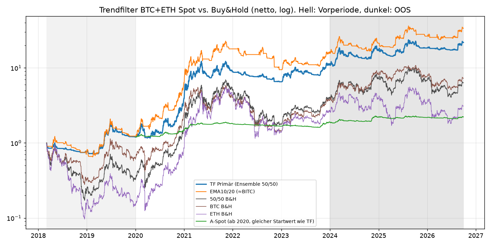
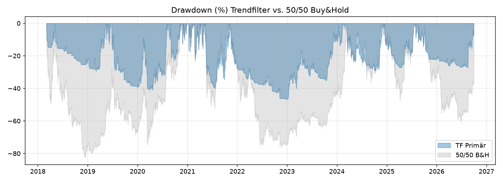

# Backtest-Bericht: Trendfilter BTC+ETH (Test 1) und Smart-DCA (Test 2)

**Stand:** 18.10.2026
**Daten:** Binance-Vision-Spot BTCUSDT/ETHUSDT ab 17.08.2017, Tageskerzen bis 30.09.2026
**Kosten:** Bitget Spot 0,10 % + 0,05 % Slippage je Trade, Mindestorder 1 USDT

Die Vorab-Registrierung liegt in `bt3/PREREG.md` und wurde vor dem ersten Lauf geschrieben. Code und Rohergebnisse liegen unter `/workspace/research/bt3/`, die Charts unter `/workspace/research/charts/` (Präfixe `tf_` und `dca_`). Alle Zahlen stammen aus diesen Läufen.

---

## 0. Ergebnis auf einen Blick

| Test | Ergebnis | Entscheidung |
|---|---|---|
| **1 – Trendfilter BTC+ETH (Primär: Ensemble aus 5 SMA, täglich, 50/50)** | Schlägt 50/50 Buy&Hold risikoadjustiert in allen Phasen (Details in Abschnitt 1). Rendite ähnlich oder höher, Drawdown deutlich kleiner. Die Statistik ist robust, mit einem Grenzwert beim PBO | **Paper-Trading: JA** |
| | **Warnsignal:** Der börsengehandelte Bitwise-Trend-ETF BITC mit ähnlicher Regel lag live weit hinter unserem Backtest (Abschnitt 1.4) | |
| **2 – Smart-DCA (Primär: Mayer Multiple, moderat, monatlich)** | Kein robuster Vorteil gegenüber normalem DCA (Details in Abschnitt 2). Je nach Startzeitpunkt mal leicht besser, mal schlechter; im Mittel ±0 | **Nicht nötig – normales DCA genügt** |

**Kennzahlen Test 1 (Primärvariante vs. 50/50 Buy&Hold)**

| Kennzahl | Trendfilter | 50/50 Buy&Hold |
|---|---|---|
| Sharpe Out-of-Sample (01/2024–09/2026) | **0,92** | 0,59 |
| CAGR Out-of-Sample | 28,5 % | 19,1 % |
| MaxDD Out-of-Sample | −29,1 % | −60,1 % |
| Sharpe lang (03/2018–09/2026) | 1,06 | 0,66 |
| MaxDD lang | −46,6 % | −82,6 % |
| Walk-Forward-Sharpe 2022–26 | 0,68 | 0,37 |

Dazu Deflated Sharpe 0,99, PBO 0,48 (knapp unter 0,5) und alle 12 Konfigurationen out-of-sample positiv.

**Kennzahlen Test 2 (Gesamt 2020–09/2026, 100 USDT/Monat)**

| Kennzahl | Normales DCA | Smart-DCA |
|---|---|---|
| IRR p.a. | 30,4 % | 29,9 % |
| Endwert je eingezahltem USDT | 2,82 | 2,77 |

Rollierende 36-Monats-Pläne: Ø IRR-Vorsprung von Smart −0,38 Prozentpunkte, Median +0,49. Monte-Carlo: P(Smart > normales DCA) 53 %.

---

## 1. Test 1 – Trendfilter BTC+ETH (long oder Cash)

**Regeln (vorab fixiert):**
- 50 % BTC-Sleeve, 50 % ETH-Sleeve, jedes Sleeve investiert oder in USDT.
- Primärsignal: Mittel der Binärsignale „Schlusskurs > SMA(n)“ für n = 20, 50, 100, 150, 200. Das Exposure läuft dadurch in Stufen von 0, 20, 40 … 100 %.
- Täglich, ab dem 00:00-UTC-Schluss; Rebalancing bei Signaländerung oder bei mehr als 20 % relativer Abweichung.
- Gitter (12 Konfigurationen): SMA50, SMA100, SMA200, EMA10/20 (≈ BITC), EMA20/50, Ensemble × täglich/wöchentlich.

### 1.1 Kernaussagen

1. **Risikoadjustiert besser als Buy&Hold in jeder Periode**, auch in der Vorperiode 03/2018–2019, die bei der Konfiguration nicht verwendet wurde:

   | Periode | Trendfilter Sharpe | Trendfilter CAGR | 50/50 B&H Sharpe | 50/50 B&H CAGR |
   |---|---|---|---|---|
   | Vorperiode 03/2018–2019 | 0,45 | +10,6 % | −0,40 | −45,5 % |
   | IS 2020–2023 | 1,37 | 73,6 % | 1,21 | 85,5 % |
   | OOS 2024–09/2026 | 0,92 | 28,5 % | 0,59 | 19,1 % |

   Im Bullenmarkt 2020–2023 lag die Rendite also unter Buy&Hold.
2. **Der eigentliche Nutzen ist der Drawdown.** Maximal −46,6 % (Mai 2021 bis Jan. 2023) gegenüber −76 bis −83 % bei Buy&Hold. Kalenderjahr 2022: −26,3 % statt −65,1 %.
3. **Das ist kein Low-Risk-Produkt.** Volatilität 42–44 % p.a.; in der Monte-Carlo-Simulation liegt P(MaxDD > 30 % in 12 Monaten) bei 43 %. Bei Crashs mitten im investierten Zustand hilft der Filter nicht; er reagiert erst mit Verzögerung.
4. **Robustheit:**
   - Alle 12 Konfigurationen sind out-of-sample positiv (Sharpe 0,53–1,18).
   - Deflated Sharpe 0,99 für 2020–26 und 1,00 für 2018–26.
   - Wahrscheinlichkeit für einen OOS-Sharpe > 0: 0,94.
   - **PBO 0,48**, also an der Grenze: Welche Signalvariante die beste ist, lässt sich nicht verlässlich vorab bestimmen. Der Filter-Effekt an sich ist aber robust.
   - Walk-Forward (meist SMA50 gewählt): Sharpe 0,68, CAGR 20,2 %, MaxDD −50,0 %. Im gleichen Zeitraum 50/50 B&H 0,37 / 4,9 % / −68,2 % und BTC 0,50 / 13,3 % / −66,9 %.
5. **Startzeitpunkt (67 rollierende 36-Monats-Fenster ab 04/2018) gegenüber 50/50 Buy&Hold:**
   - Sharpe besser in **94 %** der Fenster
   - CAGR besser in 72 % (Median +6,2 Prozentpunkte, schlechtestes Fenster −60,8 Prozentpunkte in einem Bullenlauf)
   - Drawdown besser in **100 %** der Fenster (Median +29,5 Prozentpunkte)
   - Gegenüber BTC allein: CAGR besser in 64 %, Sharpe besser in 78 %
6. **Kosten und Kapital:**
   - Turnover rund 17× p.a., Handelskosten 2,6 % p.a. Mit BGB-Rabatt (0,08 %) steigt der Sharpe nur von 1,21 auf 1,23.
   - Die Mindestorder von 1 USDT spielt bei 100, 500 und 1000 USDT keine Rolle; die Ergebnisse sind identisch.
   - Die wöchentliche Prüfung halbiert die Kosten, war aber schlechter (OOS-Sharpe 0,69).

### 1.2 Vergleich mit A-Spot (Trend-Ensemble Top-10 aus bt2)

| Kennzahl (2020–09/2026) | Trendfilter BTC+ETH | A-Spot |
|---|---|---|
| CAGR | 53,6 % | 9,5 % |
| Volatilität | 43 % | 8 % |
| Sharpe | 1,21 | 1,14 |
| MaxDD | −46,6 % | −14,9 % |
| Sharpe OOS | 0,92 | 0,81 |
| CAGR OOS | 28,5 % | 6,2 % |

Beide haben einen ähnlichen Sharpe, aber völlig unterschiedliches Risiko. **Der Trendfilter ist eine risikoreduzierte Krypto-Investition. A-Spot ist eine fast marktneutrale Low-Vol-Strategie** mit im Schnitt rund 10 % Exposure. Die Wahl ist eine Frage der Risikotoleranz, nicht der Qualität.

### 1.3 Monte-Carlo (12 Monate, Block-Bootstrap)

| Stichprobe | Strategie | P(Gewinn) | Median | 5 %-Quantil | P(MaxDD > 30 %) | P(> BTC B&H) |
|---|---|---|---|---|---|---|
| 2020–09/2026 | **Trendfilter** | 80,8 % | +47,1 % | −28,1 % | 42,9 % | 55,5 % |
| 2020–09/2026 | BTC B&H | 71,6 % | +42,7 % | −51,1 % | 78,0 % | – |
| nur OOS 2024–09/2026 | **Trendfilter** | 74,5 % | +25,1 % | −26,8 % | 23,7 % | 48,2 % |
| nur OOS 2024–09/2026 | BTC B&H | 69,5 % | +27,3 % | −41,3 % | 64,2 % | – |

Die Mediane sind wegen der Bullenphasen in der Stichprobe hoch und **keine Prognose**.

### 1.4 Warnsignal: Live-ETF BITC vs. Backtest

Der Bitwise-Trendwise-ETF BITC nutzt eine 10/20-EMA-Regel auf BTC: CME-Futures, sonst T-Bills, TER 0,85–0,88 %. Seine Live-Zahlen laut Fondsseite (Stand 29.09.2026) und unser EMA10/20-Backtest auf BTC-Spot:

| Zeitraum | BITC live | Backtest EMA10/20 BTC | BTC Buy&Hold |
|---|---|---|---|
| Seit Auflage 20.03.2023 | +27,99 % | +193,6 % (ab 21.03.2023) | +201,8 % (ab 21.03.2023) |
| 3 Jahre | +37,34 % | +218,5 % | +210,9 % |
| 1 Jahr | −12,28 % | +10,7 % | −26,8 % |

Die Lücke ist riesig. Mögliche Gründe, alle **nicht verifiziert**:
- Futures-Roll- und Basiskosten
- ETF-Mechanik und Gebühren
- Abweichende Signalberechnung oder Ausführungszeitpunkte
- Mögliche Regeländerungen seit der Auflage (nicht geprüft)

Bis die Ursache geklärt ist, gilt: **Die Backtest-Renditen nicht 1:1 erwarten.** Genau dafür ist Paper-Trading da.

---

## 2. Test 2 – Smart-DCA vs. normales DCA vs. Lump-Sum

**Regeln (vorab fixiert):**
- 100 USDT pro Monat, Sensitivität 50 USDT; wöchentlich R·12/52 jeden Sonntag. Aufteilung 50/50 BTC/ETH.
- **Gleiche Gesamteinzahlung:** Smart-DCA kauft m × Rate, gedeckelt durch das verfügbare USDT. Was nicht gekauft wird, bleibt als Reserve im Depot und wird später bei tiefem Stand eingesetzt.
- Primärschema „moderat“ auf Basis des Mayer Multiple M = Kurs / SMA200 vom Vortag:

  | M | < 0,8 | 0,8–1,0 | 1,0–1,5 | 1,5–2,4 | > 2,4 |
  |---|---|---|---|---|---|
  | Multiplikator m | 2,0 | 1,5 | 1,0 | 0,5 | 0 |

- Gitter: 3 Schemata (moderat, linear, aggressiv) × MA-Länge 100/200/365 = 9 Konfigurationen.
- Lump-Sum: die gesamte spätere Einzahlungssumme wird am Starttag investiert.

### 2.1 Kernaussagen

1. **Smart-DCA bringt keinen verlässlichen Vorteil** (50/50, 100 USDT/Monat):

   | Periode | Normales DCA IRR | Smart-DCA IRR | Normales DCA Endwert je USDT | Smart-DCA Endwert je USDT |
   |---|---|---|---|---|
   | IS 2020–2023 | 53,4 % | 51,3 % | 2,70 | 2,60 |
   | OOS 2024–09/2026 | 5,4 % | 6,5 % | 1,08 | 1,09 |
   | Gesamt 2020–09/2026 | 30,4 % | 29,9 % | 2,82 | 2,77 |
   | Lang 09/2018–09/2026 | 37,8 % | 37,9 % | 4,82 | 4,85 |

2. **Rollierende 36-Monats-Pläne (61 Starts):**
   - Primär besser in 69 % der Fenster, aber Ø −0,38 Prozentpunkte, weil die Verlustfenster größer sind (schlechtestes Fenster −5,4 Prozentpunkte, bestes +2,0).
   - Die „linearen“ Schemata sind klar schlechter (Ø −2,3 bis −3,7 Prozentpunkte).
   - PBO 0,26. Die Fenster überlappen stark, in den Daten stecken nur 2–3 echte Zyklen.
3. **Walk-Forward** (jährliche 12-Monats-Pläne): Ø Δ Endwert je USDT −0,046; Primär −0,024. Also leicht negativ.
4. **Warum kein Vorteil?** Bei gleicher Gesamteinzahlung kann Smart-DCA nur Geld verschieben, das vorher zurückgehalten wurde. In langen Bullenphasen (M > 1,5) bleibt Geld liegen, und genau dann steigt der Kurs weiter, etwa 2020/21 im IS. Die Reserve ist im Schnitt mit 0,5–3 % klein, der Effekt deshalb gering.
5. **Durchschnittlicher Einstandspreis 2020–09/2026:**

   | Asset | Smart-DCA | Normales DCA |
   |---|---|---|
   | BTC | 28.317 USDT | 28.524 USDT |
   | ETH | 1.036 USDT | 991 USDT |

   Bei BTC minimal besser, bei ETH schlechter.
6. **Wöchentlich vs. monatlich:** praktisch kein Unterschied (IRR gesamt 30,3 % vs. 30,4 % für normales DCA).
7. **Sparrate 50 vs. 100 USDT:** identische Prozentwerte. Die Mindestorder von 1 USDT greift nie, auch nicht bei wöchentlich 50 USDT mit 0,5×-Multiplikator (ca. 2,9 USDT je Coin).
8. **Lump-Sum vs. DCA:**
   - Bei steigendem Markt deutlich mehr Endvermögen: 2020–2026 16,05 statt 2,82 je USDT, denn das Geld war früher investiert. Für den Vergleich muss die Summe aber am Start verfügbar sein.
   - In der langen Periode ab 09/2018 lag die IRR unter DCA (33,5 % vs. 37,8 %).
   - In den rollierenden Fenstern gewinnt Lump-Sum nur in 49 % (IRR) und streut extrem (−115 bis +62 Prozentpunkte).
9. **Depot-Drawdown:** In allen Varianten rund −75 % (2021/22). **DCA schützt nicht vor Drawdowns**, es verteilt nur das Einstiegsrisiko.

### 2.2 Monte-Carlo (12-Monats-Sparplan, 1.200 USDT, Stichprobe 2020–09/2026)

| Plan | P(Endwert > Einzahlung) | Median Endwert je USDT | 5 %-Quantil | P(Depot-DD > 30 %) | P(besser als normales DCA) |
|---|---|---|---|---|---|
| Normales DCA | 72,7 % | 1,299 | 0,641 | 60,5 % | – |
| Smart-DCA Primär | 73,0 % | 1,301 | 0,648 | 55,1 % | 53,3 % |
| Lump-Sum | 72,4 % | 1,522 | 0,472 | 86,3 % | 66,9 % |

---

## 3. Empfehlung

**Test 1 – Trendfilter: Paper-Trading JA.**
- **Variante (vorab fixiert, nicht nachoptimieren):** Ensemble aus Kurs > SMA 20/50/100/150/200, täglich nach 00:00 UTC, 50 % BTC / 50 % ETH, Bitget-Spot, Rest in USDT.
- **Kapital:** ab 100 USDT technisch problemlos.
- **Für wen:** Es ist eine Alternative zu Buy&Hold für jemanden, der Krypto-Exposure will, aber Drawdowns von −75 bis −85 % nicht aushält. **Mit historisch bis −47 % Drawdown ist sie kein moderates Low-Risk-Produkt.**
- **Bei geringer Risikotoleranz:** A-Spot (bt2) bleibt die ruhigere Wahl. Eine Kombination (z. B. Teil A-Spot, Teil Trendfilter) wurde nicht getestet.
- **Paper-Phase:** mindestens 6 Monate. Die BITC-Lücke sollte vorher geklärt werden.
- **Abbruchkriterien:**
  - Drawdown > 50 %
  - Abweichung der Paper-Rendite vom parallel laufenden Backtest um mehr als 5 Prozentpunkte in 3 Monaten
  - Mehr als 25 Trades pro Monat (Hinweis auf Whipsaw oder einen Fehler)

**Test 2 – Smart-DCA: nicht empfohlen.** Wer monatlich spart, fährt mit **normalem DCA** genauso gut und einfacher, etwa 50–100 USDT pro Monat 50/50 in BTC/ETH (oder nur BTC). Smart-DCA kostet zwar nichts, bringt aber keinen belegten Vorteil, und die „linearen“ Varianten schaden sogar. Liegt ein größerer Betrag bereit, ist Lump-Sum im Erwartungswert besser, aber mit deutlich höherem Timing- und Drawdown-Risiko. Eine Kombination aus Sparplan und Trendfilter wurde nicht getestet; sie wäre ein möglicher nächster Test.

**Prozess:** Nur Backtests bzw. Paper-Trading. Kein Merge oder Deploy ohne deine ausdrückliche Freigabe, keine Secrets im Code, kein Push auf main.

---

## 4. Grenzen

1. **Kurze Historie:** Binance-Daten erst ab 08/2017, das sind rund 2–3 Krypto-Zyklen. Ältere BTC-Daten (z. B. Bitstamp ab 2011) wurden nicht verwendet.
2. **Ausführung zum Tagesschluss**, Slippage pauschal 0,05 %; Binance- statt Bitget-Preise.
3. **USDT-Cash unverzinst.** Eine Verzinsung (z. B. Earn) würde Trendfilter und Smart-DCA leicht begünstigen. Das Depeg-Risiko von USDT wurde nicht modelliert.
4. **Steuern** (Österreich: 27,5 % KESt auf Krypto-Gewinne seit 2022) sind nicht berücksichtigt. Der Trendfilter erzeugt viele realisierte Gewinne, DCA kaum. Das kann den Vorteil des Trendfilters nach Steuern deutlich schmälern und sollte steuerlich geprüft werden.
5. **Monte-Carlo** setzt voraus, dass die Vergangenheit repräsentativ ist; die Mediane sind durch die Bullenphasen nach oben verzerrt.
6. **Die BITC-Lücke (1.4) ist ungeklärt.**

---

## Anhang A – Trendfilter: vollständige Tabellen

#### Vorperiode 03/2018–2019

| Strategie | CAGR | Vol | Sharpe | MaxDD | Calmar | Ø Exposure | Turnover p.a. |
|---|---|---|---|---|---|---|---|
| **TF Primär: Ensemble täglich 50/50** | 10.6 % | 38.5 % | 0.45 | -39.1 % | 0.27 | 0.33 | 14.6× |
| Ensemble wöchentlich | -0.7 % | 39.9 % | 0.18 | -41.4 % | -0.02 | 0.35 | 7.1× |
| EMA10/20 täglich (≈BITC) | 12.2 % | 46.6 % | 0.48 | -46.8 % | 0.26 | 0.40 | 13.4× |
| SMA200 täglich | -11.6 % | 41.3 % | -0.09 | -44.8 % | -0.26 | 0.29 | 5.9× |
| Ensemble nur BTC | 19.0 % | 40.6 % | 0.63 | -35.9 % | 0.53 | 0.36 | 15.6× |
| Ensemble nur ETH | -0.2 % | 41.3 % | 0.20 | -42.5 % | -0.00 | 0.30 | 13.8× |
| EMA10/20 nur BTC | 1.4 % | 47.0 % | 0.26 | -51.5 % | 0.03 | 0.43 | 17.3× |
| Primär, Kosten 0,08 % | 11.7 % | 38.5 % | 0.48 | -38.7 % | 0.30 | 0.33 | 14.6× |
| BTC B&H | -22.7 % | 69.4 % | -0.02 | -72.0 % | -0.32 | – | – |
| ETH B&H | -64.7 % | 90.8 % | -0.69 | -90.1 % | -0.72 | – | – |
| 50/50 B&H | -45.5 % | 76.7 % | -0.40 | -82.6 % | -0.55 | – | – |

#### IS 2020–2023

| Strategie | CAGR | Vol | Sharpe | MaxDD | Calmar | Ø Exposure | Turnover p.a. |
|---|---|---|---|---|---|---|---|
| **TF Primär: Ensemble täglich 50/50** | 73.6 % | 49.3 % | 1.37 | -46.6 % | 1.58 | 0.60 | 17.3× |
| Ensemble wöchentlich | 78.5 % | 50.5 % | 1.40 | -46.7 % | 1.68 | 0.59 | 7.0× |
| EMA10/20 täglich (≈BITC) | 88.8 % | 51.6 % | 1.49 | -58.5 % | 1.52 | 0.56 | 12.3× |
| SMA200 täglich | 69.0 % | 55.3 % | 1.23 | -51.1 % | 1.35 | 0.62 | 6.3× |
| Ensemble nur BTC | 56.8 % | 42.8 % | 1.26 | -50.6 % | 1.12 | 0.57 | 17.3× |
| Ensemble nur ETH | 79.9 % | 62.8 % | 1.25 | -53.9 % | 1.48 | 0.62 | 17.3× |
| EMA10/20 nur BTC | 65.3 % | 46.5 % | 1.31 | -62.4 % | 1.05 | 0.54 | 12.5× |
| Primär, Kosten 0,08 % | 75.7 % | 49.3 % | 1.39 | -45.9 % | 1.65 | 0.60 | 17.3× |
| BTC B&H | 55.7 % | 67.7 % | 1.00 | -76.6 % | 0.73 | – | – |
| ETH B&H | 104.9 % | 88.5 % | 1.27 | -79.3 % | 1.32 | – | – |
| 50/50 B&H | 85.5 % | 75.1 % | 1.21 | -76.2 % | 1.12 | – | – |
| A-Spot (bt2) | 11.9 % | 8.6 % | 1.35 | -14.9 % | 0.80 | – | – |

#### OOS 2024–09/2026

| Strategie | CAGR | Vol | Sharpe | MaxDD | Calmar | Ø Exposure | Turnover p.a. |
|---|---|---|---|---|---|---|---|
| **TF Primär: Ensemble täglich 50/50** | 28.5 % | 33.0 % | 0.92 | -29.1 % | 0.98 | 0.53 | 17.6× |
| Ensemble wöchentlich | 18.9 % | 33.1 % | 0.69 | -35.6 % | 0.53 | 0.52 | 8.6× |
| EMA10/20 täglich (≈BITC) | 32.1 % | 35.9 % | 0.95 | -36.4 % | 0.88 | 0.52 | 14.9× |
| SMA200 täglich | 25.6 % | 37.3 % | 0.80 | -29.2 % | 0.88 | 0.54 | 8.7× |
| Ensemble nur BTC | 26.2 % | 31.3 % | 0.90 | -28.2 % | 0.93 | 0.56 | 19.3× |
| Ensemble nur ETH | 28.9 % | 40.0 % | 0.83 | -35.9 % | 0.80 | 0.48 | 16.0× |
| EMA10/20 nur BTC | 29.2 % | 33.2 % | 0.94 | -27.2 % | 1.08 | 0.53 | 15.9× |
| Primär, Kosten 0,08 % | 30.1 % | 33.0 % | 0.96 | -28.5 % | 1.06 | 0.53 | 17.6× |
| BTC B&H | 28.1 % | 47.3 % | 0.76 | -53.0 % | 0.53 | – | – |
| ETH B&H | 6.1 % | 68.0 % | 0.42 | -67.6 % | 0.09 | – | – |
| 50/50 B&H | 19.1 % | 55.0 % | 0.59 | -60.1 % | 0.32 | – | – |
| A-Spot (bt2) | 6.2 % | 7.8 % | 0.81 | -8.2 % | 0.75 | – | – |

#### Gesamt 2020–09/2026

| Strategie | CAGR | Vol | Sharpe | MaxDD | Calmar | Ø Exposure | Turnover p.a. |
|---|---|---|---|---|---|---|---|
| **TF Primär: Ensemble täglich 50/50** | 53.6 % | 43.4 % | 1.21 | -46.6 % | 1.15 | 0.57 | 17.4× |
| Ensemble wöchentlich | 51.3 % | 44.2 % | 1.16 | -46.7 % | 1.10 | 0.57 | 7.6× |
| EMA10/20 täglich (≈BITC) | 63.2 % | 45.9 % | 1.30 | -58.5 % | 1.08 | 0.54 | 13.4× |
| SMA200 täglich | 49.7 % | 48.8 % | 1.07 | -51.1 % | 0.97 | 0.59 | 7.3× |
| Ensemble nur BTC | 43.6 % | 38.5 % | 1.13 | -50.6 % | 0.86 | 0.57 | 18.1× |
| Ensemble nur ETH | 57.0 % | 54.7 % | 1.10 | -53.9 % | 1.06 | 0.56 | 16.8× |
| EMA10/20 nur BTC | 49.5 % | 41.6 % | 1.17 | -62.4 % | 0.79 | 0.54 | 13.9× |
| Primär, Kosten 0,08 % | 55.5 % | 43.4 % | 1.23 | -45.9 % | 1.21 | 0.57 | 17.4× |
| BTC B&H | 43.8 % | 60.2 % | 0.91 | -76.6 % | 0.57 | – | – |
| ETH B&H | 56.7 % | 80.8 % | 0.97 | -79.3 % | 0.72 | – | – |
| 50/50 B&H | 54.8 % | 67.7 % | 0.99 | -76.2 % | 0.72 | – | – |
| A-Spot (bt2) | 9.5 % | 8.3 % | 1.14 | -14.9 % | 0.64 | – | – |

#### Lang 03/2018–09/2026

| Strategie | CAGR | Vol | Sharpe | MaxDD | Calmar | Ø Exposure | Turnover p.a. |
|---|---|---|---|---|---|---|---|
| **TF Primär: Ensemble täglich 50/50** | 43.2 % | 42.4 % | 1.06 | -46.6 % | 0.93 | 0.52 | 16.8× |
| Ensemble wöchentlich | 38.3 % | 43.4 % | 0.97 | -46.7 % | 0.82 | 0.52 | 7.5× |
| EMA10/20 täglich (≈BITC) | 50.7 % | 46.0 % | 1.12 | -58.5 % | 0.87 | 0.52 | 13.4× |
| SMA200 täglich | 33.9 % | 47.3 % | 0.86 | -64.3 % | 0.53 | 0.53 | 7.0× |
| Ensemble nur BTC | 37.9 % | 39.0 % | 1.02 | -50.6 % | 0.75 | 0.52 | 17.6× |
| Ensemble nur ETH | 42.6 % | 52.1 % | 0.94 | -53.9 % | 0.79 | 0.51 | 16.1× |
| EMA10/20 nur BTC | 37.7 % | 42.8 % | 0.96 | -62.4 % | 0.60 | 0.51 | 14.6× |
| Primär, Kosten 0,08 % | 44.9 % | 42.4 % | 1.09 | -45.9 % | 0.98 | 0.52 | 16.8× |
| BTC B&H | 26.0 % | 62.3 % | 0.69 | -76.6 % | 0.34 | – | – |
| ETH B&H | 14.1 % | 83.1 % | 0.58 | -90.1 % | 0.16 | – | – |
| 50/50 B&H | 24.0 % | 69.7 % | 0.66 | -82.6 % | 0.29 | – | – |

#### Kalenderjahre (2018 ab 05.03., 2026 bis 30.09.)

| Strategie | 2018 | 2019 | 2020 | 2021 | 2022 | 2023 | 2024 | 2025 | 2026 |
|---|---|---|---|---|---|---|---|---|---|
| TF Primär | -24.4 % | 59.0 % | 224.3 % | 127.3 % | -26.3 % | 67.5 % | 55.5 % | 8.0 % | 18.7 % |
| EMA10/20 | -24.4 % | 63.1 % | 412.3 % | 183.5 % | -47.2 % | 65.9 % | 35.8 % | 24.1 % | 27.5 % |
| BTC B&H | -67.8 % | 94.3 % | 302.0 % | 59.8 % | -64.2 % | 155.6 % | 121.3 % | -6.3 % | -4.6 % |
| ETH B&H | -84.8 % | -1.7 % | 470.2 % | 399.2 % | -67.5 % | 90.8 % | 46.3 % | -11.0 % | -9.6 % |
| 50/50 B&H | -76.8 % | 42.0 % | 398.9 % | 206.0 % | -65.1 % | 122.3 % | 81.8 % | -4.7 % | -6.7 % |
| A-Spot | – | – | 21.7 % | 23.5 % | -7.5 % | 12.7 % | 16.8 % | -0.9 % | 1.8 % |

#### Alle 12 Konfigurationen (netto)

| Signal | Frequenz | Sharpe IS | Sharpe OOS | CAGR OOS | MaxDD 2020–26 | Sharpe Lang 2018–26 |
|---|---|---|---|---|---|---|
| SMA50 | täglich | 1.55 | 1.18 | 43.5 % | -56.8 % | 1.16 |
| SMA50 | wöchentlich | 1.54 | 0.75 | 23.0 % | -50.5 % | 1.02 |
| SMA100 | täglich | 1.11 | 0.88 | 29.0 % | -54.2 % | 0.97 |
| SMA100 | wöchentlich | 1.11 | 0.74 | 22.4 % | -60.5 % | 0.91 |
| SMA200 | täglich | 1.23 | 0.80 | 25.6 % | -51.1 % | 0.86 |
| SMA200 | wöchentlich | 1.29 | 0.53 | 13.8 % | -47.4 % | 0.79 |
| EMA10/20 | täglich | 1.49 | 0.95 | 32.1 % | -58.5 % | 1.12 |
| EMA10/20 | wöchentlich | 1.50 | 0.82 | 26.2 % | -49.9 % | 1.02 |
| EMA20/50 | täglich | 1.31 | 0.84 | 26.8 % | -57.5 % | 1.00 |
| EMA20/50 | wöchentlich | 1.18 | 0.93 | 30.9 % | -62.0 % | 1.01 |
| ENS | täglich | 1.37 | 0.92 | 28.5 % | -46.6 % | 1.06 |
| ENS | wöchentlich | 1.40 | 0.69 | 18.9 % | -46.7 % | 0.97 |

**Robustheit:** PBO = 0.48 (IS-beste Konfig im OOS-Teil Ø Sharpe 1.10); Deflated Sharpe Primär (2020–26, N=12) = 0.99, (03/2018–2026) = 1.00; OOS-PSR(SR>0) = 0.94; OOS positiv: 12/12, OOS-Sharpe-Spanne 0.53–1.18.

**Walk-Forward 2022–09/2026** (Auswahl nach Sharpe ab 2020): Sharpe 0.68, CAGR 20.2 %, MaxDD -50.0 % — gleicher Zeitraum 50/50 B&H: Sharpe 0.37, CAGR 4.9 %, MaxDD -68.2 %; BTC B&H: Sharpe 0.50, CAGR 13.3 %, MaxDD -66.9 %. Gewählt: 2022: EMA10/20 täglich, 2023: SMA50 wöchentl., 2024: SMA50 täglich, 2025: SMA50 täglich, 2026: SMA50 täglich

#### Kapital mit Mindestorder (1 USDT), Gesamt 2020–09/2026

| Kapital | CAGR | Sharpe | MaxDD | Ø Exposure |
|---|---|---|---|---|
| ideal | 53.6 % | 1.21 | -46.6 % | 0.57 |
| 100 USDT | 53.6 % | 1.21 | -46.6 % | 0.57 |
| 500 USDT | 53.6 % | 1.21 | -46.6 % | 0.57 |
| 1000 USDT | 53.6 % | 1.21 | -46.6 % | 0.57 |

Handelskosten Primär: 2.62 % p.a. des Kapitals.

#### Monte-Carlo 12 Monate – Stichprobe 2020–09/2026

| Strategie | P(Gewinn) | Median | 5 %-Q. | 95 %-Q. | P(MaxDD>30 %) | P(> BTC B&H) | P(> 50/50 B&H) |
|---|---|---|---|---|---|---|---|
| TF Primär | 80.8 % | 47.1 % | -28.1 % | 265.9 % | 42.9 % | 55.5 % | 46.9 % |
| EMA10/20 | 82.7 % | 58.2 % | -27.5 % | 304.1 % | 45.9 % | 59.9 % | 52.2 % |
| 50/50 B&H | 72.8 % | 52.6 % | -53.5 % | 396.6 % | 85.0 % | 58.8 % | 0.0 % |
| BTC B&H | 71.6 % | 42.7 % | -51.1 % | 307.0 % | 78.0 % | 0.0 % | 41.2 % |
| ETH B&H | 70.2 % | 54.4 % | -62.0 % | 522.2 % | 93.9 % | 54.7 % | 50.1 % |

#### Monte-Carlo 12 Monate – Stichprobe 03/2018–09/2026

| Strategie | P(Gewinn) | Median | 5 %-Q. | 95 %-Q. | P(MaxDD>30 %) | P(> BTC B&H) | P(> 50/50 B&H) |
|---|---|---|---|---|---|---|---|
| TF Primär | 76.7 % | 38.4 % | -31.0 % | 245.6 % | 44.1 % | 60.1 % | 59.9 % |
| EMA10/20 | 78.6 % | 46.5 % | -31.9 % | 276.9 % | 50.3 % | 64.0 % | 64.0 % |
| 50/50 B&H | 61.7 % | 24.5 % | -63.4 % | 329.9 % | 91.9 % | 46.1 % | 0.0 % |
| BTC B&H | 63.5 % | 25.2 % | -57.5 % | 285.0 % | 84.9 % | 0.0 % | 53.9 % |
| ETH B&H | 56.5 % | 15.6 % | -73.6 % | 396.0 % | 97.5 % | 41.8 % | 37.1 % |

#### Monte-Carlo 12 Monate – Stichprobe nur OOS 2024–09/2026

| Strategie | P(Gewinn) | Median | 5 %-Q. | 95 %-Q. | P(MaxDD>30 %) | P(> BTC B&H) | P(> 50/50 B&H) |
|---|---|---|---|---|---|---|---|
| TF Primär | 74.5 % | 25.1 % | -26.8 % | 141.2 % | 23.7 % | 48.2 % | 57.0 % |
| EMA10/20 | 74.6 % | 28.5 % | -29.3 % | 162.5 % | 30.9 % | 52.5 % | 59.3 % |
| 50/50 B&H | 61.3 % | 18.5 % | -53.7 % | 208.5 % | 82.9 % | 34.6 % | 0.0 % |
| BTC B&H | 69.5 % | 27.3 % | -41.3 % | 181.0 % | 64.2 % | 0.0 % | 65.3 % |
| ETH B&H | 52.8 % | 5.2 % | -67.4 % | 246.2 % | 94.5 % | 31.2 % | 28.0 % |

## Anhang B – Smart-DCA: vollständige Tabellen

#### Vorperiode 09/2018–2019 – 50/50 BTC/ETH, 100 USDT/Monat

| Plan | Eingezahlt (USDT) | Endwert | Endwert je USDT | IRR p.a. | Ø Einstand BTC / ETH | MaxDD Depot | MaxDD Anteilswert | Ø Cash | Cash Ende |
|---|---|---|---|---|---|---|---|---|---|
| Plain-DCA monatlich | 1.600 | 1.575 | 0.98 | -2.2 % | 5.934 / 171 | -45.3 % | -64.2 % | 0.0 % | 0 |
| **Smart-DCA Primär (Mayer 200, moderat, monatlich)** | 1.600 | 1.584 | 0.99 | -1.4 % | 5.745 / 168 | -45.9 % | -65.3 % | 1.5 % | 0 |
| Plain-DCA wöchentlich | 1.615 | 1.592 | 0.99 | -2.2 % | 5.998 / 168 | -39.2 % | -64.4 % | 0.0 % | 0 |
| Smart-DCA wöchentlich (Mayer 200, moderat) | 1.615 | 1.602 | 0.99 | -1.2 % | 5.826 / 166 | -37.8 % | -65.5 % | 1.7 % | 0 |
| Lump-Sum (Gesamtsumme am Start) | 1.600 | 1.147 | 0.72 | -22.1 % | 7.211 / 296 | -63.8 % | -63.8 % | 0.0 % | 0 |

#### IS 2020–2023 – 50/50 BTC/ETH, 100 USDT/Monat

| Plan | Eingezahlt (USDT) | Endwert | Endwert je USDT | IRR p.a. | Ø Einstand BTC / ETH | MaxDD Depot | MaxDD Anteilswert | Ø Cash | Cash Ende |
|---|---|---|---|---|---|---|---|---|---|
| Plain-DCA monatlich | 4.800 | 12.947 | 2.70 | 53.4 % | 20.035 / 695 | -75.8 % | -77.2 % | 0.0 % | 0 |
| **Smart-DCA Primär (Mayer 200, moderat, monatlich)** | 4.800 | 12.481 | 2.60 | 51.3 % | 20.426 / 716 | -75.2 % | -76.8 % | 1.1 % | 0 |
| Plain-DCA wöchentlich | 4.823 | 12.743 | 2.64 | 53.4 % | 20.080 / 718 | -75.6 % | -77.1 % | 0.0 % | 0 |
| Smart-DCA wöchentlich (Mayer 200, moderat) | 4.823 | 12.322 | 2.55 | 51.3 % | 20.379 / 740 | -74.9 % | -76.6 % | 1.3 % | 0 |
| Lump-Sum (Gesamtsumme am Start) | 4.800 | 55.888 | 11.64 | 84.8 % | 7.212 / 131 | -77.8 % | -77.8 % | 0.0 % | 0 |

#### OOS 2024–09/2026 – 50/50 BTC/ETH, 100 USDT/Monat

| Plan | Eingezahlt (USDT) | Endwert | Endwert je USDT | IRR p.a. | Ø Einstand BTC / ETH | MaxDD Depot | MaxDD Anteilswert | Ø Cash | Cash Ende |
|---|---|---|---|---|---|---|---|---|---|
| Plain-DCA monatlich | 3.300 | 3.560 | 1.08 | 5.4 % | 74.343 / 2.601 | -48.0 % | -59.8 % | 0.0 % | 0 |
| **Smart-DCA Primär (Mayer 200, moderat, monatlich)** | 3.300 | 3.610 | 1.09 | 6.5 % | 73.674 / 2.543 | -48.4 % | -60.2 % | 2.9 % | 0 |
| Plain-DCA wöchentlich | 3.300 | 3.499 | 1.06 | 4.3 % | 75.982 / 2.633 | -48.3 % | -59.9 % | 0.0 % | 0 |
| Smart-DCA wöchentlich (Mayer 200, moderat) | 3.300 | 3.534 | 1.07 | 5.1 % | 75.804 / 2.580 | -48.6 % | -60.1 % | 1.6 % | 0 |
| Lump-Sum (Gesamtsumme am Start) | 3.300 | 5.000 | 1.52 | 16.3 % | 44.246 / 2.356 | -58.5 % | -58.5 % | 0.0 % | 0 |

#### Gesamt 2020–09/2026 – 50/50 BTC/ETH, 100 USDT/Monat

| Plan | Eingezahlt (USDT) | Endwert | Endwert je USDT | IRR p.a. | Ø Einstand BTC / ETH | MaxDD Depot | MaxDD Anteilswert | Ø Cash | Cash Ende |
|---|---|---|---|---|---|---|---|---|---|
| Plain-DCA monatlich | 8.100 | 22.854 | 2.82 | 30.4 % | 28.524 / 991 | -75.8 % | -77.2 % | 0.0 % | 0 |
| **Smart-DCA Primär (Mayer 200, moderat, monatlich)** | 8.100 | 22.473 | 2.77 | 29.9 % | 28.317 / 1.036 | -75.2 % | -76.8 % | 0.7 % | 0 |
| Plain-DCA wöchentlich | 8.123 | 22.564 | 2.78 | 30.3 % | 28.640 / 1.019 | -75.6 % | -77.1 % | 0.0 % | 0 |
| Smart-DCA wöchentlich (Mayer 200, moderat) | 8.123 | 22.235 | 2.74 | 29.9 % | 28.396 / 1.064 | -74.9 % | -76.6 % | 0.8 % | 0 |
| Lump-Sum (Gesamtsumme am Start) | 8.100 | 130.024 | 16.05 | 50.9 % | 7.212 / 131 | -77.8 % | -77.8 % | 0.0 % | 0 |

#### Lang 09/2018–09/2026 – 50/50 BTC/ETH, 100 USDT/Monat

| Plan | Eingezahlt (USDT) | Endwert | Endwert je USDT | IRR p.a. | Ø Einstand BTC / ETH | MaxDD Depot | MaxDD Anteilswert | Ø Cash | Cash Ende |
|---|---|---|---|---|---|---|---|---|---|
| Plain-DCA monatlich | 9.700 | 46.716 | 4.82 | 37.8 % | 17.522 / 553 | -76.7 % | -77.2 % | 0.0 % | 0 |
| **Smart-DCA Primär (Mayer 200, moderat, monatlich)** | 9.700 | 47.004 | 4.85 | 37.9 % | 17.746 / 540 | -76.7 % | -77.2 % | 0.5 % | 0 |
| Plain-DCA wöchentlich | 9.738 | 46.776 | 4.80 | 38.0 % | 17.611 / 553 | -76.6 % | -77.2 % | 0.0 % | 0 |
| Smart-DCA wöchentlich (Mayer 200, moderat) | 9.738 | 47.014 | 4.83 | 38.1 % | 17.751 / 543 | -76.6 % | -77.1 % | 0.5 % | 0 |
| Lump-Sum (Gesamtsumme am Start) | 9.700 | 100.233 | 10.33 | 33.5 % | 7.211 / 296 | -76.8 % | -76.8 % | 0.0 % | 0 |

#### Alle 9 Smart-Konfigurationen vs. Plain (50/50, monatlich, 100 USDT) – IRR-Vorsprung in Prozentpunkten

| Schema | MA | Vorperiode 09/2018–2019 | IS 2020–2023 | OOS 2024–09/2026 | Gesamt 2020–09/2026 | Lang 09/2018–09/2026 |
|---|---|---|---|---|---|---|
| moderat | 100 | -1.18 | -0.30 | +0.11 | -0.07 | +0.08 |
| moderat | 200 | +0.77 | -2.17 | +1.03 | -0.50 | +0.15 |
| moderat | 365 | -0.39 | -0.54 | +1.22 | +0.25 | +0.39 |
| linear | 100 | +1.08 | -2.98 | +1.00 | -1.34 | -0.84 |
| linear | 200 | +4.70 | -5.00 | +1.55 | -2.23 | -1.31 |
| linear | 365 | +2.38 | -4.17 | +1.50 | -2.09 | -1.35 |
| aggressiv | 100 | -1.54 | -1.30 | +0.04 | -0.29 | +0.09 |
| aggressiv | 200 | +3.27 | -4.36 | +2.06 | -0.86 | +0.37 |
| aggressiv | 365 | -0.25 | -4.92 | +1.83 | -1.14 | +0.22 |

#### Einzel-Assets und Sparrate 50 USDT (monatlich) – IRR p.a. / Endwert je USDT

| Plan | Vorperiode 09/2018–2019 | IS 2020–2023 | OOS 2024–09/2026 | Gesamt 2020–09/2026 | Lang 09/2018–09/2026 |
|---|---|---|---|---|---|
| BTC Plain 100 USDT | 30.4 % / 1.21 | 39.2 % / 2.11 | 8.5 % / 1.12 | 31.6 % / 2.93 | 37.5 % / 4.77 |
| BTC Smart Primär 100 USDT | 33.2 % / 1.23 | 39.0 % / 2.10 | 8.8 % / 1.13 | 31.5 % / 2.92 | 37.7 % / 4.80 |
| BTC Lump-Sum 100 USDT | -0.2 % / 1.00 | 55.7 % / 5.86 | 26.1 % / 1.89 | 43.8 % / 11.60 | 35.4 % / 11.60 |
| ETH Plain 100 USDT | -33.8 % / 0.76 | 65.4 % / 3.28 | 2.3 % / 1.03 | 29.2 % / 2.71 | 38.0 % / 4.86 |
| ETH Smart Primär 100 USDT | -31.4 % / 0.77 | 62.5 % / 3.14 | 3.3 % / 1.05 | 28.2 % / 2.61 | 37.9 % / 4.84 |
| ETH Lump-Sum 100 USDT | -46.4 % / 0.44 | 104.4 % / 17.42 | 4.9 % / 1.14 | 56.5 % / 20.51 | 31.4 % / 9.07 |
| 50/50 Plain 100 USDT | -2.2 % / 0.98 | 53.4 % / 2.70 | 5.4 % / 1.08 | 30.4 % / 2.82 | 37.8 % / 4.82 |
| 50/50 Plain 50 USDT | -2.2 % / 0.98 | 53.4 % / 2.70 | 5.4 % / 1.08 | 30.4 % / 2.82 | 37.8 % / 4.82 |
| 50/50 Smart Primär 100 USDT | -1.4 % / 0.99 | 51.3 % / 2.60 | 6.5 % / 1.09 | 29.9 % / 2.77 | 37.9 % / 4.85 |
| 50/50 Smart Primär 50 USDT | -1.4 % / 0.99 | 51.3 % / 2.60 | 6.5 % / 1.09 | 29.9 % / 2.77 | 37.9 % / 4.85 |
| 50/50 Lump-Sum 100 USDT | -22.1 % / 0.72 | 84.8 % / 11.64 | 16.3 % / 1.52 | 50.9 % / 16.05 | 33.5 % / 10.33 |
| 50/50 Lump-Sum 50 USDT | -22.1 % / 0.72 | 84.8 % / 11.64 | 16.3 % / 1.52 | 50.9 % / 16.05 | 33.5 % / 10.33 |

#### Rollierende 36-Monats-Sparpläne (Starts 09/2018 – 09/2023, n = 61, überlappend) – 50/50, 100 USDT/Monat

| Konfiguration | Anteil Fenster Smart > Plain (IRR) | Ø IRR-Vorsprung (pp) | Median (pp) | schlechtestes Fenster (pp) | bestes (pp) | Ø Δ Endwert je USDT |
|---|---|---|---|---|---|---|
| moderat-100 | 61 % | +0.08 | +0.21 | -2.12 | +2.44 | +0.015 |
| moderat-200 (Primär) | 69 % | -0.38 | +0.49 | -5.38 | +2.01 | +0.004 |
| moderat-365 | 70 % | +0.34 | +0.65 | -3.67 | +4.09 | +0.012 |
| linear-100 | 18 % | -2.32 | -1.97 | -7.51 | +1.12 | -0.089 |
| linear-200 | 16 % | -3.69 | -3.00 | -12.18 | +2.35 | -0.143 |
| linear-365 | 31 % | -2.84 | -2.62 | -11.76 | +5.44 | -0.121 |
| aggressiv-100 | 57 % | -0.05 | +0.51 | -4.09 | +2.95 | +0.018 |
| aggressiv-200 | 70 % | -0.93 | +0.93 | -10.79 | +3.64 | +0.002 |
| aggressiv-365 | 64 % | -1.65 | +0.81 | -15.09 | +3.59 | -0.015 |
| Lump-Sum vs. Plain | 49 % | -3.54 | -2.03 | -114.65 | +62.07 | – |

PBO (CSCV über die 61 rollierenden Fenster, 8 Blöcke, Metrik Ø IRR-Vorsprung): **0.26**. Hinweis: Fenster überlappen stark, die effektive Zahl unabhängiger Beobachtungen ist klein (ca. 2–3 Zyklen).

#### Walk-Forward: jährliche 12-Monats-Sparpläne (Schema nach bestem Ø-Vorsprung der Vorjahre ab 2019)

| Jahr | gewählt | Plain: Endwert je USDT | Δ Walk-Forward | Δ Primär |
|---|---|---|---|---|
| 2020 | linear-200 | 2.998 | -0.230 | -0.047 |
| 2021 | moderat-100 | 1.424 | -0.103 | -0.172 |
| 2022 | moderat-100 | 0.637 | +0.002 | +0.000 |
| 2023 | moderat-100 | 1.446 | +0.000 | +0.000 |
| 2024 | moderat-100 | 1.343 | -0.006 | +0.022 |
| 2025 | moderat-100 | 0.972 | +0.012 | +0.031 |
| 2026 | moderat-100 | 1.222 | +0.005 | +0.000 |
| **Ø** | | | **-0.046** | **-0.024** |
#### Monte-Carlo 12-Monats-Sparplan (100 USDT/Monat, 1.200 USDT, 50/50; Block-Bootstrap, 5.000 Pfade, Stichprobe 2020–09/2026)

| Plan | P(Endwert > Einzahlung) | Median Endwert je USDT | 5 %-Q. | 95 %-Q. | P(MaxDD Depot > 30 %) | P(> Plain-DCA) |
|---|---|---|---|---|---|---|
| Plain-DCA | 72.7 % | 1.299 | 0.641 | 2.918 | 60.5 % | – |
| Smart-DCA Primär | 73.0 % | 1.301 | 0.648 | 2.752 | 55.1 % | 53.3 % |
| Lump-Sum 1.200 USDT am Start | 72.4 % | 1.522 | 0.472 | 4.930 | 86.3 % | 66.9 % |

#### Monte-Carlo 12-Monats-Sparplan (100 USDT/Monat, 1.200 USDT, 50/50; Block-Bootstrap, 5.000 Pfade, Stichprobe 08/2017–09/2026)

| Plan | P(Endwert > Einzahlung) | Median Endwert je USDT | 5 %-Q. | 95 %-Q. | P(MaxDD Depot > 30 %) | P(> Plain-DCA) |
|---|---|---|---|---|---|---|
| Plain-DCA | 67.2 % | 1.226 | 0.584 | 2.876 | 74.8 % | – |
| Smart-DCA Primär | 67.6 % | 1.235 | 0.585 | 2.767 | 70.8 % | 54.9 % |
| Lump-Sum 1.200 USDT am Start | 66.9 % | 1.378 | 0.399 | 4.672 | 93.8 % | 61.8 % |

#### Monte-Carlo 12-Monats-Sparplan (100 USDT/Monat, 1.200 USDT, 50/50; Block-Bootstrap, 5.000 Pfade, Stichprobe nur OOS 2024–09/2026)

| Plan | P(Endwert > Einzahlung) | Median Endwert je USDT | 5 %-Q. | 95 %-Q. | P(MaxDD Depot > 30 %) | P(> Plain-DCA) |
|---|---|---|---|---|---|---|
| Plain-DCA | 61.5 % | 1.109 | 0.633 | 1.997 | 36.3 % | – |
| Smart-DCA Primär | 61.8 % | 1.110 | 0.631 | 1.985 | 35.5 % | 52.2 % |
| Lump-Sum 1.200 USDT am Start | 61.1 % | 1.170 | 0.476 | 2.881 | 83.4 % | 56.8 % |